<div align="center">

<a href="https://github.com/MateusARJ"></a>

<a href="https://www.linkedin.com/in/mateus-de-araujo-24022b36b/"></a>
<a href="mailto:mateusarj07@gmail.com"></a>


</div>

<br/>

## 🔴 `[0x01]` RECON

```bash
┌──(mateus㉿ifpi)-[~]
└─$ nmap -sV --script=perfil mateus-araujo

PORT      STATE  SERVICE      VERSION
443/tcp   open   frontend     React · TypeScript
8081/tcp  open   mobile       React Native
8080/tcp  open   backend      Go
1337/tcp  open   security     Pentest · Bug Bounty · Análise de vulnerabilidades
3000/tcp  open   ai-pair      Claude Code · Claude · Antigravity · Jules · Google AI Studio
22/tcp    open   ssh          Kali Linux · Nobara Linux · Windows

Host:   Análise e Desenvolvimento de Sistemas — IFPI
Status: up — aberto a estágios, freelas e projetos colaborativos
```

Sou estudante de **Análise e Desenvolvimento de Sistemas no IFPI** e gosto de enxergar o software pelos dois lados: **construo** aplicações web e mobile com React, React Native, TypeScript e Go, e **quebro** aplicações para encontrar falhas antes de quem não deveria. Uso IA como parceira de desenvolvimento no dia a dia para entregar mais rápido sem abrir mão da qualidade.

<br/>

## 🔴 `[0x02]` ARSENAL

<div align="center">

<table>
<tr>
<td align="center" width="25%"><b>⚔️ Linguagens & Frameworks</b></td>
<td align="center" width="25%"><b>🤖 IA no fluxo</b></td>
<td align="center" width="25%"><b>🛡️ Segurança & SO</b></td>
<td align="center" width="25%"><b>🧰 Ferramentas</b></td>
</tr>
<tr>
<td align="center" valign="top">
<br/>
<br/>
<br/>

</td>
<td align="center" valign="top">
<br/>
<br/>
<br/>
<br/>

</td>
<td align="center" valign="top">
<br/>
<br/>
<br/>

</td>
<td align="center" valign="top">
<br/>

</td>
</tr>
</table>

</div>

<br/>

## 🔴 `[0x03]` TARGETS — projetos em destaque

<div align="center">


<a href="https://github.com/orbita83/Orbity"></a>
<a href="https://github.com/MateusARJ/Eng-Software-III-E2E"></a>
<a href="https://github.com/MailsonSousa88/pedeaqui"></a>

<a href="https://github.com/MateusARJ?tab=repositories"></a>

</div>

<br/>

## 🔴 `[0x04]` LOOT — estatísticas

<div align="center">


</div>

<br/>

## 🔴 `[0x05]` PAYLOAD — contribuições

<div align="center">

<picture>
  <source media="(prefers-color-scheme: dark)" srcset="https://raw.githubusercontent.com/MateusARJ/MateusARJ/output/snake-dark.svg" />
  <source media="(prefers-color-scheme: light)" srcset="https://raw.githubusercontent.com/MateusARJ/MateusARJ/output/snake.svg" />
  
</picture>

<sub>🐍 Cobra vermelha consumindo o histórico de contribuições — atualizada todo dia via GitHub Actions.</sub>

</div>

<br/>

## 🔴 `[0x06]` SESSION

<div align="center">

</div>

<br/>

<div align="center">

```diff
- "Hackers não quebram sistemas. Eles exploram falhas humanas."
```

**Achou alguma vulnerabilidade no meu código? Me avisa. 😉**

<a href="https://www.linkedin.com/in/mateus-de-araujo-24022b36b/"></a>

</div>


